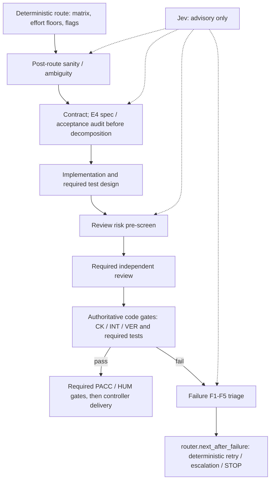

# Hermes engineering swarm v2 — start here

Give your Hermes agent this folder. Nothing in it makes an API call, creates a Hermes task, reads a credential or grants spending authority. It is a policy, an offline planner that turns a task into a concrete graph, and the tests that hold the policy to the spec.

| File | Purpose |
|---|---|
| `SPEC.md` | The v2 specification (effort × task-type matrix, typed task graph, gates, cost and time controls, availability modes §11.1, Hermes binding). Read §2–§9 before anything else. |
| `policy.json` | Policy as data: effort levels, task types, the 70-cell matrix, route templates, modifiers, path→type/flag map, failure classes, tiers with primary and alternate, **availability modes (easy/medium/hard/expert)**, model registry with timestamped prices, scheduling. |
| `router.py` | Offline planner. Task JSON in, route JSON out: classification, cell, budget check, acyclic graph with tier/model pins per the active mode, critical-path dispatch order, Hermes card shapes. |
| `test_router.py` | Tests mapped to the thirteen acceptance criteria in `SPEC.md` §15, including the availability-mode tests (criterion 13). |
| `workflow.top.mmd`, `workflow.item.mmd` | The two graphs from `SPEC.md` §6, byte-identical to the spec (a test checks). |
| `task.example.json` | The v1 example task (payments webhook) expressed in the v2 task schema. |
| `route.example.json` | The plan the router emits for it: `R2+EGH`, $11.08 planned against a $25 ceiling. |

## 1. Run the offline package first

```bash
python3 router.py task.example.json --today 2026-09-08
python3 router.py task.example.json --today 2026-09-08 --mode easy    # availability modes: easy | medium | hard | expert
python3 -m unittest -v test_router.py
```

**Operating modes (spec §0 — rigor levels, not model rosters; v2.2).** Pick one per task (task JSON `"mode"` or `--mode`). A mode may only raise rigor, width, budget/time ceilings or gates — it never removes a recipe, premium gate, human interrupt, secret rule, idempotency rule or verification requirement. Model selection is decoupled from the mode: every tier is filled from the tier registry and each model dispatches on its own provider account. A user-selected mode is a floor, not a ceiling — the router may raise it from task type/effort/flags (T7/T11/T13/T14 or critical T8 → expert; E3+, no-repro bug, cross-module, concurrency, new design → hard; normal code change → medium; else easy), never lower it. Safety flags (critical, payments, secrets, destructive, pii → +G; prod, destructive, external-writes → +H) always win over the mode.

- **easy** (default) — routine workflows, cron jobs, simple setup; least expensive verified route, one owner, no advanced knobs.
- **medium** — normal product/engineering changes; matrix as written, independent test design + cross-family review for E2, width 4.
- **hard** — cross-module, high-risk, production-adjacent; raises effort one level on material uncertainty (no reproduction, prior failed attempt), stronger reviewer, R3/R4 when E3+.
- **expert** — foundational, security/data/schema, policy/routing, irreversible writes; premium judge for +G, +H before irreversible actions, E1–E2 bounded items under one milestone contract.

Plans report `mode.{selected, derived, effective, rank, raise_reason, effort_raises, substitutions}`; any raise from the selected floor to the effective level is logged. A plan that names a model with no dispatchable provider route fails closed as `dispatch_refused`.

`--today` pins the registry-freshness check for reproducible output. Without it the planner uses the real date and will refuse to plan once any price entry is older than `scheduling.registry_max_age_days` (30) — that refusal is the intended behavior, not a bug. Refresh `registry.*.price.checked_at` after re-checking the publisher page.

## 2. Inspect the installed Hermes before binding anything

Confirm each of these against your installed version; the spec's binding (§13) was checked against the public docs on September 8, 2026.

```bash
hermes --version
hermes kanban create --help        # expect --assignee, --model, --provider, --parent, --idempotency-key, --json
hermes kanban set-model --help
hermes profile list                # or the equivalent in your version
```

What v2 relies on:

- Kanban cards accept a per-card `--model` and `--provider`; the dispatcher spawns the worker with that pin.
- Children of parents that are all `done` are created `ready`; the controller still gates on `TaskState` acceptance, not on `done`.
- `--idempotency-key` returns the existing card on a repeat call. The router emits `"<task_id>:<attempt>:<node>"` as the key.
- `delegate_task` uses one `delegation.model` per profile, so it is used only for homogeneous fan-out inside a card; the heterogeneous graph is Kanban.
- Subagents get a fresh conversation plus the workspace's `.hermes.md`, which is how the item contract reaches every worker and reviewer.
- There is no wall-clock timeout unless `child_timeout_seconds` is set. The router sets it per card from the cell's time ceiling.

## 3. Create the profiles

One profile per tier and role, least privilege, model provider authenticated under your own account:

```
eng-local      L   Ollama on the Mac Studio; width 2; also the stage-2 classifier
eng-flash      F   qwen3.8-27b (implementer) / qwen-coder-flash / glm-5.3-flash / gemini-3.8-flash / grok-4.6
eng-mid        M   glm-5.3 (implementer) / qwen3.8-27b / grok-4.6 / kimi-k2.7-code
eng-high       H   claude-sonnet-5 / gpt-5.6-sol; gpt-5.6-sol for coordination (conductor, since 2.2.1)
eng-judge      P   gpt-6-astra; declared alternate in policy.json, logged on every use
eng-reviewer   —   pinned per card to a different family from the implementer it reviews
eng-integrator —   deterministic; a model only on conflicts
```

Set `delegation.max_concurrent_children`, `child_timeout_seconds` and the iteration limit in each worker profile to the tier's values in `policy.json` → `effort_levels.*.hermes`. Keep `max_spawn_depth` at 1; only the controller creates follow-up cards.

## 4. Bind the registry to your accounts

You reach models through direct provider accounts, so for every enabled entry in `policy.json` → `registry`:

1. Clear each `_confirm` by checking the provider's current API reference: usage field names (the ledger reads these, never the model's own report), reasoning-control parameter names, tool-schema quirks, cache semantics.
2. Fill `rate_limits` from your account; the scheduler caps width with them.
3. Point `key_ref` at where the key actually lives (`env:NAME` or `keychain:NAME`). Never write a key value anywhere in this folder — `test_router.py` scans for key-shaped strings and fails if it finds one.
4. Re-check the price on the publisher page, set `checked_at`, and note the context band. Qwen Coder Flash remains carried from v1 unverified. Grok 4.6 one-shot availability was verified on both OpenRouter and direct xAI on 2026-10-16. Its recorded prices are verified OpenRouter metadata only; direct xAI pricing is unverified, and its direct xAI provider/account binding is preserved.
5. Set `hermes.provider` to the provider name your Hermes install uses.

The premium judge's `alternate` is declared as `claude-opus-5` at price parity with Astra's standard short-context rate; it is disabled until you decide. Substitution is always logged; never silent.

## 5. Stand up the controller

The router plans; the controller runs. It needs, in this order:

1. A state store outside the chat — SQLite in the controller profile's directory is enough — holding `TaskState` (§7) and the append-only event log.
2. Card creation only after the parents' semantic gate reads `accepted` in `TaskState`, using the `hermes_cards[].cli` shapes the router emits and mapping returned `t_<hex>` IDs to node IDs.
3. The item contract written into each item worktree's `.hermes.md` (and a reviewer variant that says not to read the implementer's notes).
4. The failure classifier calling `router.next_after_failure()` and following the returned edge — models label failures, they do not choose edges.
5. `+H` and `+G` as pauses: the graph waits on a decision field and resumes from the checkpoint.
6. Ledger reconciliation from provider usage fields, and the pre-dispatch check `spent + in_flight_reservations + next_call_upper_bound <= effective_limit`.

## Advisory pipeline: Jev and authoritative gates

This is a process overlay for the controller, not additional executable router nodes. Solid arrows show the policy-controlled path (optional nodes follow the selected route); dotted links show Jev's advisory input at four judgment nodes.



Jev can flag route ambiguity, suggest an F1-F5 classification, identify review risk, and audit E4 specifications and acceptance criteria. The controller applies the deterministic route and failure edges; code gates, required reviews, premium acceptance and human interrupts retain authority. Jev's disagreement or uncertainty may raise rigor or escalate, but must never lower rigor, bypass tests or grant approval. Advisory agreement is not acceptance, merge or deploy authority.

## 6. Smoke, then pilot

Run one small task per route family under an existing budget with a $5 task ceiling, and confirm: cards were created once (repeat the run; idempotency keys should return the same IDs), timeouts fired when expected, the reviewer was a different family than the implementer, the premium gate refused to accept a revision that differed from the one it saw, and the ledger matches the provider invoices.

Then the pilot in `SPEC.md` §14: 30–50 tasks across cells, compared to single-agent baselines, with per-cell acceptance rate, cost per accepted item and p95 lead time. Promote or demote routes cell by cell; any change to `policy.json` is itself a T14 task with eval replay.

## Do not

- Paste `policy.json` into Hermes configuration; it is not Hermes schema.
- Fragment a critical item into small cards to avoid the premium gate; the router logs it as a policy violation.
- Substitute the premium judge silently, drop tests, the recipe or a gate to fit a budget, or treat "all parents done" as "accepted".
- Let a model choose an edge. Edges are computed from `TaskState` fields; models fill fields.


T14 policy v2.2.3: MAIN/default and H coordination use `gpt-5.6-sol`, provider `openai-codex` (ChatGPT subscription), reasoning `high`. Model-specific dispatch emits all three fields and direct worker `--reasoning high`; Kanban cards inherit profile base effort (medium or restricted-direct none); bare subscription Sol resolves exact high, and four evidenced non-subscription namespaces have exact prior-base counters (create has no reasoning flag). No API key or OpenRouter Sol slug is used. Delegated worker selection, cross-family review, premium gates, delegation limits and fallback chains remain authoritative. Offline plans do not prove account availability or live enforcement.
