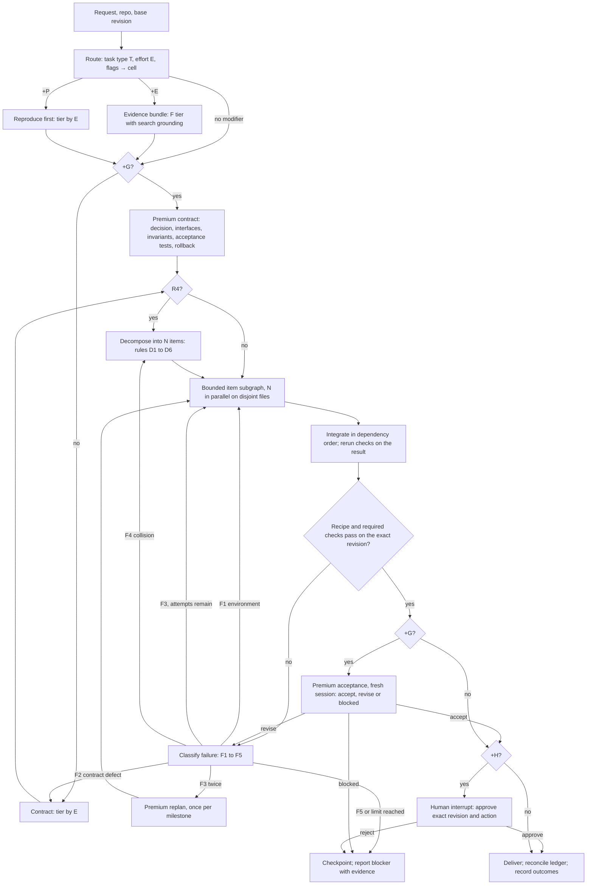
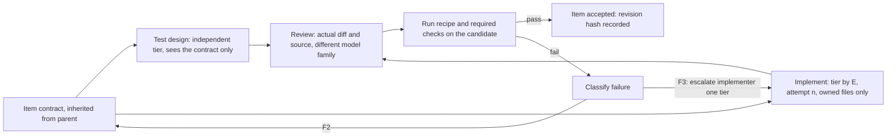
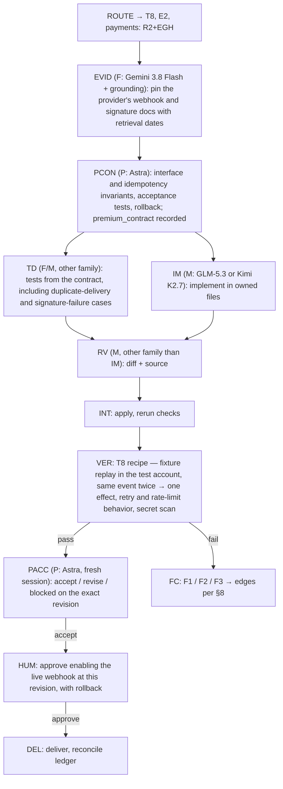

# Hermes engineering swarm v2 — effort × task-type routing on a typed task graph

Revision of the September 8, 2026 v1, for the operator • v2 drafted September 8, 2026

The operating principle is unchanged: **the least expensive route that reliably delivers a verified result, with the premium judge responsible for the highest-impact judgment**. Hermes owns execution, task state, dependencies, permissions and accounting. Models are replaceable specialists inside that system.

What v2 changes, in one paragraph: v1 routed on *difficulty* and *impact* and drew the graph as a picture of who does what. v2 routes on **effort** and **task type**, and specifies the graph the way a graph runtime needs it — a typed shared state, nodes that read and write declared fields, edges computed from state rather than from a model's opinion, reusable subgraphs for the repeated unit of work, checkpoints at every edge, and human/premium gates as first-class interrupt nodes. Cost controls from v1 are kept and joined by time controls, because a swarm that is cheap but slow is not the goal.

Conventions used in this document: `> v2 change` callouts mark what moved and why. Text without a callout is carried from v1, sometimes tightened. Everything with a dollar or minute figure is a configurable starting value, never a price estimate or spending authorization; the user's existing limits always win.

## Change log: v1 → v2

| # | What changed | Why | Where |
|---|---|---|---|
| 1 | Routing axes: difficulty + impact → **effort × task type**. Impact becomes a derived set of flags that can raise a route but never lower it. | Task type determines the *shape* of a route (which nodes exist, which verification recipe counts as proof). Effort determines the *tier* (model, ceiling, attempts, width, time). v1's impact tags were carrying task-type information implicitly ("payments", "migrations", "auth" are kinds of work, not just risk levels). | §2–§5 |
| 2 | Graph definition: control-flow picture → **typed `TaskState`**, a node catalog with declared reads/writes, and subgraphs. | v1's "durable state", "idempotency keys", "reject stale completions" cannot be implemented without a state schema. Every one of them is now a field or an event. | §6–§7 |
| 3 | Evidence collection: unconditional box in the v1 diagram → **`+E` modifier** attached by task type. | v1 prose said evidence was conditional; the diagram said every task visits it. The router needs a rule, not a caption. | §3, §6 |
| 4 | Repair loop: escalate on failure *count* → escalate on failure **class** (F1–F5) and count. | A stronger model does not fix a flaky sandbox or an ambiguous contract; it bills more for the same failure. Edges are now keyed on what failed. | §8 |
| 5 | Time: absent → **per-cell wall-clock ceilings**, critical-path scheduling, pipelined review, batched acceptance, and Hermes timeouts set per tier. | v1 optimized spend only. Hermes subagents have no wall-clock timeout unless configured. | §4, §9, §13 |
| 6 | Models: nine named roles → **five tiers** (L local, F flash, M mid, H high, P premium judge), each with a primary and a declared alternate. Local tier added. | Routing on tiers keeps the matrix stable when a model changes. The Mac Studio is $0 marginal for E0–E1 work and for the classifier. Fewer live provider dependencies on the critical path. | §11 |
| 7 | Router: unspecified → **three stages** (deterministic rules → local classifier → Sol on disagreement). | Having a $1–$2/M-input planning model classify a typo costs more than fixing the typo. Classification is also a prediction, so re-routing is defined. | §2 |
| 8 | Pricing: hard-coded table → **registry read at run time**, with a corrected snapshot in Appendix A. | On re-check today the three OpenAI rows in v1 were exactly 2× the standard short-context prices published on the pricing page — consistent with a Priority-tier reading, not Standard. Astra is half the cost v1 assumed, and cached input is 10× cheaper than uncached. Policy should not embed prices. | §10, App. A |
| 9 | Premium judge: Astra only, no substitution → Astra primary plus a **declared, logged, cross-family alternate**. | v1 forbade *silent* downgrade, which is right. A provider outage should not stop every critical item; a declared alternate at premium tier is not a downgrade. | §11, §12 |
| 10 | Human approval: terminal "checkpoint and report blocker" → **`+H` interrupt node** that resumes. | Approval before an irreversible or external action is a normal step in the graph, not a failure state. | §6, §12 |
| 11 | Decomposition: "split into bounded items" → **rules D1–D6**. | Parallel width, integrator load and critical path all follow from how work is split. | §9 |
| 12 | Evaluation: compare the whole graph → **per-cell metrics** that promote or demote routes cell by cell. | This is what "a routing policy trained on your own engineering work" means operationally. | §14 |
| 13 | Package: acceptance criteria added for `policy.json`, `router.py`, `test_router.py`. | The matrix must be executable and tested, not prose. | §15 |

Kept from v1 without structural change: Astra's three placements; the $0.50–$75 ceilings; the 35% verification/recovery reservation; the atomic reservation check; the three-attempt hard stop; contracts first; independent test design and cross-family review; one integration point; evidence over votes; acceptance is not merge or deploy authority; the 30–50-task pilot; the Hermes Kanban binding (re-verified against the current docs today, §13).


## 0. Operating mode overrides

This spec is the default engineering-swarm policy. The requester or coordinator may set an operating mode, but the mode may only raise rigor, width, budget/time ceilings, or gates when the task type/impact flags require it. A mode never removes a mandatory recipe, premium gate, human interrupt, secret rule, idempotency rule, or verification requirement.

| Mode | Use when | Override behavior | Minimum proof |
|---|---|---|---|
| **Easy mode** | Routine team workflows, cron jobs, simple setup, and tasks where the safe default is obvious. | Use the least expensive verified route; prefer human-readable schedules, default delivery, narrow prompts, one owner, and no optional advanced knobs. Route E0–E1 work through R0/R1 unless task type/flags require more. | Artifact exists; relevant check/readback passes; cron/job/profile/skill loads successfully when applicable. |
| **Medium mode** | Normal product/engineering changes where several files or an external contract may be involved. | Default to the matrix as written. Use independent test design and cross-family review for E2. Cap parallelism at disjoint owned-file sets, default width 4. | Contract plus targeted or independent tests; reviewer sees diff/source, not the implementer report; verification recipe passes on exact revision. |
| **Hard mode** | Cross-module, high-risk, ambiguous, production-adjacent, or failure-prone work. | Raise effort one level when uncertainty is material; require explicit contract, stronger reviewer, evidence bundle when useful, and stricter time/spend checkpoints. Use R3 or R4 when E3+ or when decomposition reduces risk. | Integration/failure-injection checks where relevant; blocking findings resolved; state/event log records attempts, failures, gates, and exact revision. |
| **Expert mode** | Foundational architecture, security/data/schema, policy/routing changes, irreversible external writes, or anything the operator flags as expert. | Treat as T13/T14 or critical row as appropriate. Use premium judge for contract/acceptance where flags or matrix require `+G`; use human interrupt `+H` before irreversible actions. Decompose into E1–E2 bounded items under one approved milestone contract. | Premium/human gates satisfied when required; holdout/eval replay for policy changes; readback/proof from external systems; ledger and final artifact reconcile. |

Mode-selection rules:

1. Default to **Easy mode** for recurring team workflows unless the user names another mode or the router derives critical/high-risk flags.
2. **Medium mode** is the normal default for code changes that are not obviously trivial and not clearly high risk.
3. **Hard mode** starts when E3 is predicted, reproduction is missing for a bug, multiple systems interact, or prior attempts failed.
4. **Expert mode** starts when T7, T11, T13, critical T8, or T14 policy/skill/routing work changes downstream agent behavior.
5. User-selected mode is a floor, not a ceiling: the router may raise rigor but may not lower below the selected mode without an explicit user instruction and no conflicting impact flags.
6. Safety flags win over mode. `critical`, `payments`, `secrets`, `destructive`, and `pii` still add `+G`; `prod`, `destructive`, and `external-writes` still add `+H`.

## 1. Graph engineering rules

> v2 change: new section. v1 applied several of these implicitly ("each attempt is an acyclic task graph with new IDs", "store state outside the chat"). v2 states them as rules so the router, the controller and the tests can be checked against them.

| Rule | Statement | What it buys |
|---|---|---|
| G1 Typed state | One `TaskState` per task (§7). Every node is a function that reads and writes declared fields. Nothing is communicated through chat transcripts. | Auditability; replay; the eval loop reads the same fields the runtime writes. |
| G2 Side effects are events | File writes, card creation, external calls and spend are appended to the event log with an idempotency key before and after they happen. | Safe resume after a crash; no duplicate cards, no double-charged retries. |
| G3 Edges are computed, not chosen | Which node runs next is a pure function of state fields (`task_type`, `effort`, `impact_flags`, `failure_class`, `attempt`, gate decisions). Models *fill* fields; they never *pick* edges. | A model cannot talk its way past a gate or into a cheaper route. Every route is reproducible from the log. |
| G4 Subgraphs for repetition | The bounded work item is one subgraph (§6), instantiated N times. A project is decompose → N items → integrate → accept. | One place to fix the item flow; width is a parameter, not a redesign. |
| G5 Explicit joins | Every fan-out declares its join (all-of, first-of) and its merge rule (append lists; the integrator resolves file conflicts). | No ambiguity about when "done" is done. |
| G6 Checkpoint every edge | State is persisted after every node; any checkpoint can be resumed; completions for a superseded attempt are rejected by attempt ID. | Interrupts, crash recovery, and cheap retries of a single node. |
| G7 Interrupts are nodes | Premium gates and human approvals pause the graph at a node with the full state available, then resume on a decision. | the operator can approve from a phone hours later and the graph continues where it stopped. |
| G8 Bounded loops with typed exits | Every cycle has a counter, a ceiling and exit edges keyed on failure class (§8). Loops unroll into acyclic attempt graphs with new IDs. | No infinite repair loops; every exit is a documented outcome. |
| G9 Critical-path scheduling | The controller knows the DAG and dispatches ready nodes in longest-remaining-path order, pipelining review behind implementation. | Wall-clock is bounded by the longest chain, not by the sum of items. |
| G10 Observability is the log | Each node emits start, end, usage by provider, cost, revision, decision. There is no separate telemetry. | The pilot in §14 costs nothing extra to instrument. |
| G11 Policy is data | Matrix, ceilings, registry, impact map and tier assignments live in `policy.json`, versioned and covered by `test_router.py`. Changing them is a T14 task with eval replay. | Routing can be tuned per cell without touching the controller. |
| G12 Context by reference | Nodes receive anchors — paths, revisions, hashes, log refs — and fetch what they need. Only summaries with anchors travel in state. | Premium context is spent on judgment, not on transcripts (kept from v1). |

## 2. Routing: from request to a cell

> v2 change: v1 did not say who assigns difficulty and impact or what it costs. v2 makes routing a three-stage node with its own budget, and treats effort as a prediction that will sometimes be wrong.

### 2.1 Output of routing

Routing writes `route.task_type` (T1–T14, §3), `route.effort` (E0–E4, §4), `route.impact_flags` (a set), and derives `route.cell` = matrix[T][E] plus modifiers (§5). It also records `route.rationale` and `route.stage` (which stage decided).

### 2.2 Three stages

| Stage | Who | Decides | Cost |
|---|---|---|---|
| 1 Deterministic | Rules in `policy.json` | Task type and impact flags from the path→type/impact map (2.3) and request keywords; a first effort estimate from files likely touched, presence of a reproduction, whether a public interface changes, whether tests exist. | $0 |
| 2 Local classifier | L tier (Mac Studio) | Confirms or proposes (T, E) with a one-line rationale when stage 1 is inconclusive. Never lowers an impact flag. | $0, ~seconds |
| 3 Planning model | Sol (the coordination model, §11) | Runs only when stages 1 and 2 disagree, when E ≥ 3, or when any critical flag is set — a second opinion before a premium gate is paid for. | one short call |

The requester may set flags and may raise effort. No stage and no model may remove a flag or lower effort below stage 1's floor for a critical row (T7, T11).

### 2.3 Impact flags from paths

Impact is derived, not declared. `policy.json` carries a CODEOWNERS-style map from paths to task type and flags. Starting entries for your stack:

| Path pattern (examples) | Task type | Flags |
|---|---|---|
| `**/migrations/**`, `prisma/schema.prisma`, `**/*.sql`, `**/seed*` | T7 Data & schema | `critical`, `destructive` |
| `**/auth/**`, `**/middleware*`, `**/*permission*`, `**/*secret*`, `.env*` | T11 Security & access | `critical`, `secrets` |
| `.github/workflows/**`, `vercel.json`, `netlify.toml`, `railway.*`, `Dockerfile` | T12 Infra & deploy | `prod` when the target environment is production |
| `**/webhooks/**`, `n8n/**`, `**/integrations/**`, `**/hubspot/**`, `**/meta/**`, `**/smartsheet/**`, `**/intacct/**` | T8 Integration & automation | `external-writes`; add `payments` for `**/stripe/**`, `**/paycove/**`, `**/billing/**`; add `pii` for student/contact record paths |
| `**/*.test.*`, `__tests__/**`, `fixtures/**` (only these touched) | T4 Tests & fixtures | — |
| `docs/**`, `*.md` (only these touched) | T1 Mechanical edit | — |
| `skills/**`, `.hermes/**`, `bundle/roles/**`, `policy.json`, `router.py` | T14 Agent, skill & policy | `high` (changes everything downstream) |

Flag effects are uniform across the matrix: any `critical`, `payments`, `secrets`, `destructive` or `pii` flag adds the premium gate `+G`; any `prod`, `destructive` or `external-writes` flag adds the human interrupt `+H` before the irreversible action. This is how "a two-line authorization fix can require Astra" from v1 is enforced mechanically.

### 2.4 Re-routing

Effort is a prediction. Re-routing is allowed only along these edges, and every re-route is an event:

- **Up** on an F3 failure (§8), one level per failure, or when the reproduction step (`+P`) fails at the current tier.
- **Down** for the items produced by an R4 plan: each item is routed on its own and most land at E1–E2.
- **Sideways** to another task type when the matrix cell says `→Tn` (§5). A "mechanical edit" that turns out to touch behavior becomes a refactor or a feature; a "bug fix" that needs a design decision becomes an architecture item.
- Never down for a critical row, never by removing a flag.

## 3. Dimension A — task types (rows)

> v2 change: new axis. Each row fixes three things v1 left to judgment: the default impact, the route family with its modifiers, and the **verification recipe** — what counts as proof for this kind of work. The examples column is deliberately specific to your repositories and tools so the deterministic router has something to match.

| Code | Task type | Examples from your stack | Default impact | Route family | Verification recipe — what "verified" means here |
|---|---|---|---|---|---|
| T1 | Mechanical edit | Formatting, rename, typo, comment/doc change, config value, dependency patch bump with lockfile | low | R0 / R1 | Lint, format, typecheck, build and existing tests pass; diff confined to owned files; no behavioral change (AST-level diff or an F-tier reviewer for R1). |
| T2 | Bug fix, reproducible | A failing test or exact steps exist; wrong total on a report page; broken form validation | from path map | R0–R3 | Reproduction test is red on the base revision and green on the candidate; targeted tests for the touched module; regression suite for the touched package. |
| T3 | Bug fix, no reproduction | "Sometimes fails in prod", intermittent webhook drop, a sync job that skips rows | from path map | R1–R4 `+P` | First produce a reproduction (failing test or scripted repro). If none within the `+P` ceiling, stop with evidence — no fix attempt. Then as T2, plus a root-cause statement anchored to file and revision. |
| T4 | Tests & fixtures | Add coverage, repair flaky tests, build fixtures for the recruiter pipeline app | low | R0–R3 | New tests fail when the behavior they cover is deliberately broken (mutation spot-check, at least one assertion per test file); tests assert on contract, not implementation details. |
| T5 | Feature: backend, API, service | New endpoint, job, report query, HubSpot property sync logic | from path map | R0–R4 | Contract tests for every changed interface; consumers of a changed interface enumerated and updated or shown unaffected; independent test design from the contract; review of diff plus source. |
| T6 | Feature: frontend, UI | Next.js page or component, job-finder UI, form flow | from path map | R0–R4 | Build; real browser run of the acceptance scenarios; screenshots at the contract's viewports compared against the contract by a vision-capable F/M model; accessibility check where tooling exists; snapshot tests alone are not evidence. |
| T7 | Data & schema | Postgres migration on Railway, seed script, HubSpot property backfill, bulk record edit | **critical**, `destructive` | R1–R4 `+G +H` | Dry run against a snapshot or copy; forward *and* rollback executed; row counts and checksums reconciled before and after; seeds and backfills idempotent and scoped by explicit filters; `+H` before touching any shared environment. |
| T8 | Integration & automation | Webhook handler, Meta Ads sync, n8n workflow writing to Smartsheet, Sage Intacct export, cron job | high, `external-writes` (+`payments`/`pii` by path) | R1–R4 `+E +H` | Fixture-payload replay in a sandbox or test account; idempotency proven (same event twice → one effect); retry and rate-limit behavior tested; external API contract pinned with primary documentation link and retrieval date; `+H` before enabling live external writes; secrets only via environment or broker. |
| T9 | Refactor, behavior-preserving | Extract module, rename across packages, dependency major upgrade, remove dead code | from path map | R0–R4 | Existing tests pass unchanged (edits only for compile-level fallout, confirmed by the reviewer); characterization tests added first where coverage is thin; public interfaces unchanged unless the contract says so. |
| T10 | Research & evidence | Dependency comparison, "how does module X work", platform capability check, spike | low | RE | Evidence bundle: sources with URL, retrieval date and snippet; each claim tagged PASS / FAIL / NOT YET PROVEN; at most two competing options; an explicit "what would change this conclusion". No code. |
| T11 | Security, auth, permissions, secrets | Role check, session handling, API key handling, OAuth scope change, key rotation | **critical**, `secrets` | R1–R4 `+G +H` | Negative tests (unauthorized paths denied); secret scan of the diff; no secret value ever enters model context; threat sketch for the changed surface; `+G` contract and acceptance; `+H` before rotation or any production change. |
| T12 | Infra, CI, deploy, environment | Vercel/Netlify env var, Railway service config, GitHub Actions workflow, build settings | high when `prod` | R0–R4 `+H` (prod), `+G` at E3+ | Plan or dry run (preview deployment, `--dry-run`, plan output) reviewed; apply; readback of live state matches intent; rollback path executed at least once outside production for E2+. |
| T13 | Architecture & design decision | Service boundary, data model for a new product, choosing between two integration designs | high | R4 (plan head) | An ADR: decision, at most two alternatives considered, interface/invariant contract, acceptance tests, rollback conditions, and a decomposition into items that each land in a cell of this matrix. No code in this item. |
| T14 | Agent, skill & policy engineering | Hermes skill, role YAML, prompt, this routing policy, `router.py` | high | R0–R4 `+V` | Eval replay on the pilot set and holdout shows no regression in acceptance rate, cost per accepted item or lead time; `test_router.py` passes; any matrix change is itself reviewed cross-family. |

Rows T7 and T11 are critical by construction: the gate does not depend on effort. Row T8 becomes critical when the `payments`, `pii` or `secrets` flag is derived from its paths.

## 4. Dimension B — effort levels (columns)

> v2 change: "difficulty" is renamed **effort** and defined as *expected work to reach a verified result*, not perceived hardness. The five levels and the v1 dollar ceilings are kept. New per-column parameters: time ceiling, gate reserve, parallel width, and the Hermes limits that enforce them.

| Parameter | E0 Trivial | E1 Small | E2 Medium | E3 Large | E4 Foundational |
|---|---|---|---|---|---|
| What it looks like | Mechanical, deterministic, one file, minutes | One module, reproducible, roughly under 50 changed lines, under an hour | Several files, needs independent test design, up to a day | Cross-module or cross-service, concurrency, debugging without a clear cause, multi-day | Architecture, novel design, major ambiguity; must be decomposed before implementation |
| Implementer tier (§11) | L; F if L is busy or unavailable | L when idle and the item is serial; otherwise F | M | H | P plans; items implement at their own E |
| Test design | Existing checks only | Implementer writes targeted tests | Independent, F or M tier, runs in parallel with implementation | Independent, M or H tier, in parallel | Per item |
| Reviewer | None — deterministic checks are the review | F tier, different family, diff only | M tier, different family, diff plus source | H tier, different family, plus behavioral evidence | H per item, then P acceptance |
| Implementation ceiling (v1, kept) | $0.50 | $2 | $8 | $25 | $75 for the plan; items carry their own; a separate project ceiling |
| Gate reserve when `+G` | $1.50 | $1.50 | $3 | $6 | Included in the $75 |
| Time ceiling, wall clock | 10 min | 30 min | 2 h | 6 h | Plan ≤ 1 h; each item its own; milestone ceiling set in the plan |
| Attempts before escalation | 1, then → E1 | 1, then → E2 | 1, then → E3 | 2, then premium replan once (v1) | Items follow their own E; one replan per milestone |
| Hard stop | 2 attempts | 2 | 3 | 3 | 3 per item, 1 replan |
| Parallel width | — | 1 | ≤ disjoint owned-file sets, default cap 4 including reviewers | Same, cap 4 | Width = number of disjoint items, capped by provider rate limits, budget reservation and integrator throughput |
| Hermes limits per child (starting values) | 15 iterations, 10 min timeout | 30 / 30 min | 50 / 2 h | 80 / 6 h | Per item |

The time ceiling covers the **implementation path** — test design, implement, review, checks, integrate, verify. Planning time (evidence, contract, and reproduction under `+P`, which gets its own ceiling of the same size) and gate time (premium sessions, human waits) are tracked separately and do not consume it, exactly as the gate reserve sits outside the implementation ceiling. Hermes `child_timeout_seconds` for the item's cards is set from this ceiling.

Reading the two ceilings together: an E0 item on a critical row still costs $0.50 to implement, plus a $1.50 gate reserve. That is the price of "a two-line authorization fix requires Astra" and it is accepted; do not fragment or reclassify work to avoid it. Gate reserves are recomputed from the registry (§10), not hard-coded — at today's standard prices a contract-plus-acceptance pair on a small item is well under $1.

## 5. The matrix

> v2 change: this table is the policy. Each cell names a route family from §6 and its modifiers. `→Tn` means the request is misclassified — route it as that task type. `↑E1` means the minimum effort for that row is E1. Flags from §2.3 add `+G` and `+H` on top of any cell.

| Task type \ Effort | E0 | E1 | E2 | E3 | E4 |
|---|---|---|---|---|---|
| T1 Mechanical edit | R0 | R1 | →T9 or T5 | →T9 or T5 | →T13 |
| T2 Bug fix, reproducible | R0 | R1 | R2 | R3 | →T13 |
| T3 Bug fix, no reproduction | ↑E1 | R1+P | R2+P | R3+P | R4+P |
| T4 Tests & fixtures | R0 | R1 | R2 | R3 | →T13 |
| T5 Feature: backend/API | R0 | R1 | R2 | R3 | R4 |
| T6 Feature: frontend/UI | R0 | R1 | R2 | R3 | R4 |
| T7 Data & schema | R1+GH | R1+GH | R2+GH | R3+GH | R4+GH |
| T8 Integration & automation | R1+EH | R1+EH | R2+EH | R3+EH | R4+EH |
| T9 Refactor | R0 | R1 | R2 | R3 | R4+G |
| T10 Research & evidence | RE | RE | RE | RE | →T13 |
| T11 Security & access | R1+GH | R1+GH | R2+GH | R3+GH | R4+GH |
| T12 Infra, CI, deploy | R0 (+H if prod) | R1 (+H if prod) | R2 (+H if prod) | R3+GH | R4+GH |
| T13 Architecture decision | →re-route | →re-route | →re-route | R4 (plan head only) | R4 |
| T14 Agent, skill & policy | R0+V | R1+V | R2+V | R3+GV | R4+GV |

Legend — route families: **R0** Direct (no model review), **R1** Light, **R2** Standard, **R3** Heavy, **R4** Planned (decompose → items → integrate → accept), **RE** Evidence only. Modifiers: **E** evidence bundle first, **P** reproduction first, **G** premium gate (contract before implementation, fresh-session acceptance after), **H** human interrupt before the irreversible or external action, **V** eval replay before acceptance.

Reading a cell: a HubSpot webhook handler change with a `payments` flag at E2 is T8 × E2 = `R2+EH`, plus `+G` from the flag → `R2+EGH`: evidence bundle, premium contract, standard item subgraph with independent test design and cross-family review, fixture replay and idempotency proof, premium acceptance on the exact revision, human approval before the live webhook is enabled. Appendix B walks through it.

Cells that never occur (`→`) are not gaps: they are the router telling the requester the request was described as one kind of work but is another.

## 6. Route templates as subgraphs

> v2 change: v1 had one diagram covering all cases. v2 has one top-level graph whose nodes are switched on by the cell, plus a single **bounded-item subgraph** that every route family instantiates one or more times (G4). Evidence and reproduction became modifiers; the failure classifier became a node; human approval became an interrupt node instead of a terminal state.

### 6.1 Top-level graph



The picture is still a state machine with bounded repair loops; each attempt is an acyclic task graph with new IDs and the controller carries attempt counts across cards (kept from v1). `+V` (T14) runs the eval replay inside the VER node.

### 6.2 Bounded-item subgraph (instantiated by R1–R4)



Route families differ only in which nodes of the subgraph are live and at what tier:

| Family | Contract | Test design | Implement | Review | Checks | Used by |
|---|---|---|---|---|---|---|
| R0 Direct | Inline in the request | — | L/F | — (deterministic checks are the review) | Recipe | E0 cells on non-critical rows |
| R1 Light | Short, written by the implementer's tier and checked by the reviewer (or by P when `+G`) | Implementer | L or F | F, different family, diff only | Recipe + targeted tests | E1 cells; E0–E1 on critical rows |
| R2 Standard | Written by M tier (or P when `+G`) | Independent F/M, parallel | M | M, different family, diff + source | Recipe + independent tests | E2 cells |
| R3 Heavy | Written by H tier (or P when `+G`); `+E` common | Independent M/H, parallel | H | H, different family, plus behavioral evidence | Recipe + integration and failure-injection checks | E3 cells |
| R4 Planned | P writes the milestone contract and decomposition | Per item | Items at their own E | Per item, then P acceptance of the milestone | Per item, then on the integrated revision | E4 cells; T13 |
| RE Evidence | Question and success criterion | — | F tier (Gemini-class with search grounding; L for summarization) | Second F/M model checks claims against sources | PASS / FAIL / NOT YET PROVEN per claim | T10 |

### 6.3 Node catalog

| Node | Reads | Writes | Tier |
|---|---|---|---|
| ROUTE | `request`, repo path map | `route.*` | rules → L → Sol |
| EVID (`+E`) | `request`, `route` | `evidence.sources[]`, `evidence.bundle_ref` | F |
| REPRO (`+P`) | `request`, `evidence` | `evidence.repro_ref`; may raise `route.effort` | by E |
| CON / PCON | `request`, `route`, `evidence` | `contract.*`; PCON also `gates.premium_contract` | by E / P |
| SPLIT (R4) | `contract` | `items[]` as child `TaskState`s with inherited gate refs | P (decision) + controller (mechanics) |
| TD | `contract` only — never `work.candidates` | `work.tests_ref` | F/M/H by E |
| IM | `contract`, `evidence`, `request.base_revision` | `work.candidates[+1]` with diff ref, revision, usage | by E and attempt |
| RV | `contract`, candidate diff and source by ref | `work.review_findings[]` | different family from IM |
| INT | accepted candidates, `work.tests_ref` | `work.integration_revision`, `verification.required_checks[]` | deterministic; a model only on conflicts |
| VER | recipe, `work.integration_revision` | `verification.*` | tools; F for browser comparison |
| FC / FCI | `verification`, `work.review_findings`, implementer report | `work.failure_class`, `work.attempt` | rules; L to label ambiguous cases |
| PRE | reproducer, both candidates, diffs, measured failures | `contract.*` revised, `gates.premium_replan` | P |
| PACC | `contract`, exact revision, findings, check evidence | `gates.premium_acceptance` | P, fresh session |
| HUM (`+H`) | everything above, plus the action about to be taken | `gates.human` | human |
| DEL | all | `status`, `ledger` reconciled, final events | controller |

### 6.4 Swarm mechanics carried from v1

These rules still hold and now have a place in the graph: ambiguous tasks stay in CON until the uncertainty is resolved enough to test the outcome; the test designer never sees implementation commentary (TD reads `contract` only); the reviewer gets the actual diff and source, not the implementer's account; author and reviewer are different model families; verification depth rises with the recipe — targeted checks for small edits, integration and failure-injection checks for concurrency and migrations, real browser interactions and screenshots for UI; a neutral integrator applies accepted work in dependency order and any later change invalidates the old acceptance; **evidence over votes** — a claimed bug needs an affected path, a reproducible scenario or a defensible invariant violation, a dismissal needs counterevidence, agreement among models is not proof, and important ambiguity gets at most two competing designs followed by a decision grounded in tests and constraints (`work.review_findings[]` carries `anchor`, `claim` and `evidence` for exactly this reason); only the controller creates follow-up cards.

## 7. `TaskState`

> v2 change: new. This is the object every node reads and writes (G1). It lives in the state store (§13), never in a chat. Field names are the ones `policy.json`, `router.py` and the event log use.

```yaml
TaskState:
  ids:        {task_id, parent_id, attempt, idempotency_key}
  request:    {goal, non_goals, requester_flags[], repo, base_revision, requested_by, requested_at}
  route:      {task_type, effort, impact_flags[], cell, modifiers[], rationale, stage, history[]}
  contract:   {acceptance_criteria[], owned_files[], interfaces[], invariants[], rollback,
               tool_permissions[], ceilings: {usd, minutes, gate_reserve_usd}, required_outputs[],
               inherited_gate_ref}
  evidence:   {bundle_ref, sources[]: {url, retrieved_at, snippet, claim, status}, repro_ref}
  items:      [child task_ids]                      # R4 only
  work:       {candidates[]: {attempt, tier, model, provider, revision, diff_ref, usage, outcome},
               tests_ref, review_findings[]: {severity, path, anchor, claim, evidence, resolved},
               integration_revision, failure_class, attempt}
  verification: {required_checks[]: {name, status, revision, log_ref},
                 recipe_results[], browser_artifacts[], eval_replay_ref}
  gates:      {premium_contract: {session_id, decision, ref, at},
               premium_replan:   {session_id, decision, ref, at},
               premium_acceptance: {session_id, decision: accept|revise|blocked, reasons[], revision, at},
               human: {decision: approve|reject, by, at, revision, action}}
  ledger:     {spent_usd, reserved_usd, in_flight[]: {node, upper_bound_usd, provider},
               effective_limit_usd, by_provider{}, time_spent_min, time_ceiling_min}
  status:     routed|evidence|contracted|implementing|integrating|verifying|gated|
              awaiting_human|accepted|delivered|blocked|stopped
  events:     append-only [{at, node, kind: start|end|side_effect|decision|spend, payload, idempotency_key}]
```

Rules that follow from the schema: `gates.premium_acceptance.revision` must equal `work.integration_revision` at delivery, otherwise the acceptance is void (v1: any subsequent change invalidates acceptance). `gates.human.action` names the exact irreversible action approved; a different action needs a new interrupt. A completion whose `ids.attempt` is below `work.attempt` is rejected (G6). `ledger` is reconciled from provider usage fields, never from the model's own report of what it used.

## 8. Failure classes and the repair loop

> v2 change: v1 escalated on the *count* of failed candidates. v2 classifies the failure first and keys the exit edge on the class (G3, G8). The counts and the hard stop from v1 are kept for the one class where they belong.

| Class | What happened | Edge | Counts as a failed candidate? | Charged to |
|---|---|---|---|---|
| F1 Environment | Flaky test, sandbox or dependency problem, transport error, rate limit | Fix the environment or retry once at the same tier. A second F1 on the same item → STOP and report; the harness is the problem. | No | Overhead |
| F2 Contract defect | Implementer reports ambiguity; tests and criteria contradict; test designer and reviewer disagree on intent | Back to the contract node at the current cell's planning tier. Not a model escalation. | Only if the implementation was also wrong | Item |
| F3 Implementation shortfall | Tests red, blocking review findings, recipe fails | Escalate the implementer one effort tier and retry (v1). After the second F3 → premium replan once. After the third → STOP with evidence preserved. | Yes | Item |
| F4 Integration collision | Merge conflicts, cross-item breakage after integration | Back to SPLIT: re-partition owned files; serialize the collision point. Not an implementer failure. | No; counts against the milestone's single replan | Milestone |
| F5 External blocker | Permission missing, provider outage, third-party down, funds or time exhausted | Checkpoint and human. No model escalation. | No | — |

Transport retries stay separate, bounded and charged; non-idempotent external actions are never blindly retried (kept). The premium replan receives the reproducer, both approaches, diffs and measured failures, and is asked to name the failed assumption and authorize one different approach — never generic encouragement to try again (kept).

## 9. Time: scheduling for wall clock

> v2 change: new section. v1 mentioned a "time/spend ceiling" as a contract field and set no times. Time is now a first-class ceiling per cell (§4) and the controller schedules on the critical path (G9).

**Critical path of a planned route.** Wall clock for R4 is approximately `plan + max(item) + integrate + verify + accept`. Everything below attacks the `max(item)` term and keeps the serial terms short.

**Decomposition rules (D1–D6).**

| Rule | Statement |
|---|---|
| D1 | One owner per item. |
| D2 | Concurrent items own disjoint files. Shared collision points — schemas, lockfiles, migrations, routing tables, generated clients — become their own items and are serialized on the critical path. |
| D3 | Every item has a testable acceptance criterion inherited from the milestone contract. |
| D4 | Target E1–E2 per item. An item that cannot be brought under E3 is a T13 question, not an item. |
| D5 | Items are similar in size: the longest is at most twice the median. One straggler defines the milestone's lead time. |
| D6 | Items under a `+G` parent carry `contract.inherited_gate_ref`; if an item's assumptions diverge from the approved contract, it needs a new gate. Fragmenting work to evade the gate is a policy violation the router logs (kept from v1). |

**Scheduling rules.**

- Test design starts when the contract is written, in parallel with implementation — the test designer sees the contract before any implementation commentary anyway (v1). This removes a serial step from every item.
- Evidence (`+E`) runs during planning, not after it.
- Review is pipelined: the reviewer takes each item as it lands rather than waiting for all items.
- The integrator is deterministic and serial; a model is consulted only on a conflict, with both owners' evidence (v1).
- Premium acceptance of several independent small items is **batched into one fresh session per milestone**, with one verdict per item per exact revision. Fewer premium sessions, same rigor.
- Width is a parameter: the number of disjoint items, capped by the tier's provider rate limits, by the reservation check (§10), and by integrator throughput. The local tier's width is 1–2 (one machine); wide fan-out goes to the flash tier.
- Ready nodes are dispatched in longest-remaining-path order; off-path cards are held when width is saturated.
- Hitting a time ceiling is an F5: checkpoint and report, exactly like running out of funds.

**Cost of time.** Local inference is $0 marginal but occupies the machine; treat its minutes as a cost in the ledger so that "free" work never lengthens the critical path.

## 10. Cost: ceilings, reservations, caching

Kept from v1: the per-item ceilings (§4), a separate total project ceiling, the 35% reservation of each item's ceiling for verification and recovery (a reservation, not a consumption target), and the atomic pre-dispatch check `spent + in_flight_reservations + next_call_upper_bound <= effective_limit`, with the effective limit the minimum of task, project and daily remaining limits, reservations counted centrally, and reservations retained for calls whose billing outcome is unknown. Total run cost still comes from uncached input, cache read/write/storage, billable output and reasoning, paid tools, failed attempts, orchestration, verification and sandbox/CI, without double-counting reasoning, using provider usage fields and invoices as the source of truth.

> v2 change: prices leave the spec. The controller reads them from `registry` in `policy.json` with a `checked_at` timestamp and a context band, and refuses to dispatch to a model whose price entry is older than a configured age. Reasons: (a) the OpenAI rows in v1 were 2× the standard short-context prices published today (Appendix A) — a hard-coded table hid the error inside a design document; (b) every provider verified today offers cached input at roughly 10–20% of the uncached price, which changes how context should be structured more than any list-price difference between the mid-tier models.

**Batch processing.** Use a provider's batch tier (Gemini's is 50% off) only for work that is off the critical path — evidence bundles prepared ahead of a milestone, eval replays, holdout scoring — never for a node another node is waiting on (kept, made specific).

**Gate reserve.** When a cell carries `+G`, the gate reserve (§4) is added to the item's ceiling and is recomputed from the registry as two premium calls at the item's expected context size. The reserve is what makes cheap critical items possible without fragmenting them.

**Caching rules.** Structure every prompt as *stable prefix → item-specific tail*: coding standards, repository map, and the approved contract first; the diff, findings and evidence last. Keep the prefix byte-identical across the calls of one item so it is served from cache. The premium judge's fresh acceptance session (§12) is a new conversation, not a new prefix — the approved contract is the same cached bytes it saw when it wrote it. Track cache hit ratio per node in the ledger; a node with a low hit ratio has an unstable prefix and is paying 5–10× too much for input.

**Where the money goes.** For E2+ work, cost is dominated by repeated context reads across 20–200 calls per item, not by the single-call arithmetic in v1's table. The pilot (§14) replaces the sample-call column with measured cost per accepted item per cell. Until then, weight list prices by expected call count per tier.

**Break-even reminder (kept, sharpened).** A cheap model that needs multiple repairs can cost more than the premium judge solving the problem once. With premium input at $5/M standard (not $10/M), the break-even moves further toward running P directly on genuinely hard E3 items where a cheap attempt has little credible chance of success.

**When funds or time are insufficient:** reduce scope or stop with a checkpoint. Never drop tests, the recipe, or a mandatory gate to make the bill fit (kept).

## 11. Tiers and registry

> v2 change: the matrix routes to **tiers**, not to named models. Each tier has a primary and a declared alternate; the v1 roster maps into the tiers below. A local tier is added. Grok becomes optional. The premium judge gains a declared alternate.

| Tier | Role in the graph | Primary (from the v1 roster) | Declared alternate | Provider accounts |
|---|---|---|---|---|
| **L** Local | Stage-2 router, E0 implementer, summarization, log triage, evidence extraction; width 1–2 | Open-weight coder model on the Mac Studio via Ollama (the Qwen/GLM coder class that fits in 96 GB unified memory) | F tier | none |
| **F** Flash | E1 implementer, routine tests, extraction, evidence maps and screenshot comparison, cheap cross-family review, fresh-source research with search grounding | Qwen Coder Flash; GLM-5.3-Flash; Gemini 3.8 Flash (vision, grounding) | each other; Grok 4.6 if kept | Alibaba, Z.ai, Google |
| **M** Mid | E2 implementer, independent test design, mid review | Kimi K2.7 Code; GLM-5.3 | each other | Moonshot, Z.ai |
| **H** High | E3 implementer, strong review, integration-conflict analysis, planning coordination (Sol) | Claude Sonnet 5; GPT-5.6 Sol; GPT-5.6 Sol for coordination | the other family (the cross-family author/reviewer pairing is built into this tier) | Anthropic, OpenAI |
| **P** Premium judge | Contracts for `+G`, replans after two F3s, acceptance for `+G`, T13 decisions | GPT-6 Astra | a second premium model from a different family, configured in the registry and logged on every use — Claude Opus 5 is at price parity with Astra's standard short-context rate today; the choice is yours | OpenAI (+ the alternate's provider) |

**On Grok.** v1 gave Grok 4.6 the "fresh research" role. Gemini 3.8 Flash with Google Search grounding covers fresh-source research inside the F tier (5,000 grounded requests per month are included, then $14 per 1,000). That removes one provider account, one key to rotate and one usage format to reconcile from the critical path. Keep Grok in the registry as an F/M alternate for targeted counterexamples if you want a fourth family available.

**Reducing the roster for the pilot.** Every provider account is a key to secure and rotate, a billing relationship, a rate limit, a usage schema and a set of tool-schema quirks. Start the pilot with one primary per tier (five models) and add alternates as the per-cell data (§14) shows where a second model earns its place. This is consistent with v1's own closing advice to keep assignments configurable and measure before defaulting.

**Direct-provider adapter requirements.** You reach these models through separate provider accounts, so each entry in `registry` must record:

| Field | Why the controller needs it |
|---|---|
| `usage_fields` — names of input, cached-input, output and (if separate) reasoning token counts in the response | Ledger reconciliation from the provider's numbers, not the model's report |
| `reasoning_controls` — the provider's parameter names and allowed values | Effort settings translate per provider; a wrong name is silently ignored by some APIs |
| `tool_schema` — parallel tool calls supported, strict-schema support, known quirks | The controller adapts tool definitions per provider instead of per prompt |
| `rate_limits` — RPM and TPM per key | Width caps per tier (§9) |
| `cache` — automatic or explicit breakpoints, TTL, read/write prices | Prompt structuring (§10) and the cache-hit metric |
| `price` — input, cached input, output, per context band, with `checked_at` and source URL | Gate reserve, upper bounds, staleness refusal |
| `key_ref` — a reference to where the key lives (profile environment or macOS keychain), never the key | Keys never enter `TaskState`, the event log or any model context. A rotation touches one place per provider and is followed by a smoke task on each route that uses it. |

**Provider outage.** An ordinary specialist may be replaced by its prequalified alternate automatically, logged. The premium judge may be replaced only by its declared premium alternate, logged with the reason, and the acceptance record names which model decided. Never silently (kept and extended).

## 12. Gates

**Premium judge placements (kept from v1, three places):**

1. **Before critical implementation** — goal, constraints, evidence, competing options and blast radius in; a concrete architecture decision, interface and invariant contract, acceptance tests and rollback conditions out. Implementation starts only when the contract is coherent.
2. **After two failed candidates** — reproducer, both approaches, diffs and measured failures in; the failed assumption identified and one different approach authorized out.
3. **Before critical acceptance** — a **fresh session** with the approved contract, exact final revision, independent findings and command evidence in; `accept`, `revise` or `blocked` with reasons tied to evidence out. It cannot override failed required checks.

Reserve premium context for relevant source, decisions and evidence; keep raw logs and full repository contents by reference with file and revision anchors (kept).

> v2 change: the human interrupt is specified as a node, and the premium judge has a declared alternate (§11).

**Human interrupt (`+H`).** Triggered by the flags in §2.3 and the cells in §5: anything that applies to a shared or production environment, writes to an external system, rotates a secret, or is destructive. The node pauses the graph and presents: the contract, a diff summary with anchors, verdicts and check evidence, the exact revision, the exact action about to be taken, and the rollback path. Decisions are `approve` or `reject`, scoped to that revision and that action; a changed revision or a different action needs a new interrupt. On `approve` the graph resumes at the next node; on `reject` it checkpoints and reports. The graph can wait indefinitely; nothing else on the item runs while it waits, and unrelated items continue.

**Completion (kept).** Required checks pass on the exact final revision, blocking findings are resolved, required premium acceptance exists, required human approval exists, and the resulting action is within the user's existing authority. The judge's engineering approval does not authorize a merge or a deployment by itself.

## 13. Hermes binding

> v2 change: v1's two integration claims were re-verified against the current Hermes documentation today and both hold. The binding below adds what v2 needs — state store, per-tier profiles, timeouts, contract delivery through workspace context files — and uses Hermes' native idempotency keys.

**What the docs confirm (checked September 8, 2026).**

- Kanban supports per-card model and provider pins: `hermes kanban create "<title>" --assignee <profile> --model <id> --provider <name>`, `hermes kanban set-model <id> <model> --provider <name>`, and the same parameters on the `kanban_create` tool. "The dispatcher spawns the worker with the pinned model."
- Dependencies are parent→child links; "a child whose parents are all `done` is created directly in `ready`." Children of open parents wait in `todo` until the dispatcher's `recompute_ready` step promotes them.
- Card creation accepts `--idempotency-key`; "any subsequent call with the same key returns the existing task id instead of duplicating." `--json` returns structured output with IDs of the form `t_<hex>`.
- `delegate_task` uses a single global pin per profile (`delegation.model`, `delegation.provider`); "`delegate_task` has no per-task model parameter." Defaults: `max_concurrent_children` 3, `max_spawn_depth` 1, 50 iterations per child, and **no wall-clock timeout** unless `child_timeout_seconds` is set.
- Subagents start with a completely fresh conversation and receive the workspace's project context files (`.hermes.md` → `AGENTS.md` chain → `CLAUDE.md` → `.cursorrules`) in their system prompt; they inherit the parent's toolsets minus `delegate_task`, `clarify`, `memory`, `send_message`, `cronjob`, and return a structured summary, or `status: "failed"` with the error.
- Profiles live under `~/.hermes/profiles/<name>/config.yaml`; the documented cost strategy is a frontier orchestrator with inexpensive worker profiles. No native budget limits are documented — accounting stays host-side, as v1 said.

**Binding rules.**

| Concern | Binding |
|---|---|
| Heterogeneous graph | Kanban cards, one per live node of the expanded graph, each pinned to the tier's model and provider. `delegate_task` is used only for homogeneous fan-out *inside* one card (for example, F-tier parallel test writing), with that profile's `delegation.model` pinned to the F tier. |
| Profiles | One profile per tier and role: `eng-local`, `-flash`, `-mid`, `-high`, `-judge`, `-integrator`, `-reviewer` (reviewer profiles are pinned to a different family from the implementer they review). Least privilege per profile, consistent with the team bootstrap. |
| Idempotency | `--idempotency-key "<task_id>:<node>:<attempt>"` on every card; the same key on the event log entry that records the creation (G2). |
| Readiness vs. acceptance | "All parents are done" is not "artifacts accepted" (kept). The controller creates a child card only after `TaskState` shows the parents' semantic gate as `accepted`; the Kanban dependency is a second safety, not the decision. |
| Contract delivery | The controller writes the item contract into the item worktree's `.hermes.md`, so every worker and reviewer reads the same contract from the workspace without the controller pasting it into prompts. The reviewer's `.hermes.md` variant says explicitly not to read the implementer's notes. |
| Time ceilings | `child_timeout_seconds` and the iteration limit are set from the cell (§4) on every dispatch. `max_spawn_depth` stays 1; only the controller creates follow-up cards (kept). |
| State store | `TaskState` and the event log live in a SQLite file in the controller profile's directory (or Postgres if shared). Kanban is the execution queue; the state store is the source of truth. |
| Interrupts | `+H` and `+G` nodes are cards assigned to the `judge` profile or to a human queue; the controller polls the decision field and resumes from the checkpoint (G6, G7). |
| Prompts and permissions | Runtime restrictions enforce permissions; prompts only explain them (kept). Tool permissions come from `contract.tool_permissions` per card. |

Example native shape after confirming the installed version and the profile:

```bash
hermes kanban create "Implement item 3 of the approved payments webhook milestone" \
  --assignee eng-mid --model glm-5.3 --provider zai \
  --parent t_contract_id --idempotency-key "task_9f2:IM:1" --json
```

Provider names are whatever your Hermes install lists them as; confirm before use. Native Hermes fields stay separate from this package's policy fields; `policy.json` is not Hermes configuration (kept). Before real execution: resolve credentials without exposing them, confirm each model's tool and schema behavior, translate reasoning controls per provider, bind cost accounting, and run a smoke task on each route under an existing budget (kept).

## 14. Make the swarm better with evidence

Kept from v1: 30–50 representative tasks split by type and effort, including known bugs and realistic integration failures; comparison against single-agent Claude Sonnet 5 and GPT-5.6 Sol, and of the hardest/critical subset against Astra alone; same repository state, tools, acceptance harness and total spend limit; acceptance rate, escaped defects, total cost per accepted item, p50/p95 completion time, repair attempts and human rework minutes; unseen holdout tasks and uncertainty intervals before changing defaults; revalidation when providers, model versions, prompts or tooling change.

> v2 change: the unit of evaluation is the **matrix cell**. The event log (G10) already carries `route.cell`, tier assignments, usage, outcome and timings, so per-cell metrics are a query, not a project.

**Per-cell promotion and demotion (starting rules).**

- Promote a cheaper or faster route or tier for a cell only after at least 10 accepted items in that cell, with acceptance rate at or above the current route's and zero escaped defects in the window.
- Demote (raise the tier or add a modifier) on two escaped defects in a cell, or when acceptance falls below the configured floor for that row.
- Any change to the matrix is a T14 task: replay the pilot and holdout sets, require non-regression on acceptance, cost per accepted item and p95 lead time, and log the policy version in every subsequent event.
- Report cost per accepted item and p95 lead time side by side; a route that saves 20% of spend and doubles lead time is not an improvement unless the row is off the critical path.

The lasting advantage is unchanged: good task boundaries, reliable execution, independent evidence, and a routing policy trained on your own engineering work.

## 15. Package changes and acceptance criteria

> v2 change: new. v1 shipped `policy.json`, `router.py`, `test_router.py`, `workflow.mmd` and the examples. These are the changes that make the matrix executable.

**`policy.json` gains:** `task_types[]` (code, name, default_flags, route_family_by_effort, recipe, examples), `effort_levels[]` (tiers, ceilings, gate_reserve, time_ceiling, attempts, hard_stop, width, hermes_limits), `matrix{}` (T × E → cell), `route_templates{}` (live nodes and tiers per family), `modifiers{}`, `impact_map[]` (path patterns → task type and flags), `flag_effects{}`, `failure_classes{}` (edges and counting rules), `decomposition_rules[]`, `tiers{}` (primary, alternate, provider), `registry{}` (per model: prices with `checked_at` and context band, `usage_fields`, `reasoning_controls`, `tool_schema`, `rate_limits`, `cache`, `key_ref`), `scheduling{}` (default width caps, batch acceptance on/off), `policy_version`.

**`router.py` gains:** stage-1 deterministic classification (stage 2 and 3 as offline stubs that read fixtures); matrix lookup with `→Tn` and `↑E` handling; subgraph expansion to a concrete DAG with unique node IDs per attempt; the failure-class edge function; critical-path ordering of emitted cards; gate-reserve computation from the registry; a staleness refusal for registry entries older than the configured age.

**`workflow.mmd`** becomes two files: the top-level graph and the item subgraph in §6.

**Acceptance criteria for the v2 package.**

1. Every (T, E) cell in `policy.json` resolves to a valid route family with modifiers, an explicit `→Tn` re-route, or an explicit `↑E` floor; `test_router.py` enumerates all 70 cells.
2. Rows T7 and T11 carry `+G` and `+H` at every effort; any `critical`, `payments`, `secrets`, `destructive` or `pii` flag adds `+G` in any cell; any `prod`, `destructive` or `external-writes` flag adds `+H`.
3. No router stage and no fixture can remove a flag or lower effort below the floor of a critical row; the test proves it with adversarial fixtures.
4. Implementation ceilings, gate reserves, time ceilings and Hermes limits are non-decreasing in E.
5. Expanded graphs are acyclic, every node ID is unique per attempt, and a second expansion of the same attempt produces the same IDs (idempotent expansion).
6. Failure-class transitions match §8 exactly, including "second F1 → stop", "F3 twice → replan once", "third F3 → stop", and "F4 → re-partition without counting a candidate".
7. Emitted card order is longest-remaining-path first; a fixture with one long item and three short ones dispatches the long one first.
8. The v1 example (payment webhook, high impact, difficulty 2) routes under v2 as T8 with the `payments` flag at E2 → `R2+EGH`, stays within a user-supplied $25 ceiling including the gate reserve, and produces the graph in Appendix B.
9. The registry carries `checked_at` for every price; the router refuses a dispatch plan when any used entry is older than the configured age, and the test covers both sides of the threshold.
10. No file in the package contains a key, token or price without a source and timestamp; the existing secret-scan test passes.
11. The Mermaid in §6 renders without error; `workflow.mmd` files match the document.
12. The package still creates no API calls, provider accounts or live Hermes tasks (kept from v1).

## Appendix A — Pricing snapshot

Prices are USD per million tokens. "Verified today" means the publisher page was fetched during the v2 review on September 8, 2026; the other rows are carried from v1 unverified because the page could not be fetched during the review. The registry, not this table, is what the controller reads.

| Model | Tier | Input | Cached input | Output | Verified today | Note |
|---|---|---|---|---|---|---|
| Qwen Coder Flash | F | $0.144 | — | $0.574 | no — carried from v1 | Alibaba pricing page did not expose the Coder Flash row on fetch; input ≤32K band; prices rise at larger context tiers; Global deployment is not US-only processing |
| GLM-5.3-Flash | F | $0.15 | $0.03 | $0.50 | yes | List rate; a 50% promotion ends September 9, 2026 24:00 UTC+8 |
| Gemini 3.8 Flash | F | $0.75 | $0.075 | $3.75 | yes | Through December 31, 2026; doubles January 1, 2027. Batch is 50% off. Google Search grounding: 5,000 requests/month included, then $14 per 1,000 |
| Kimi K2.7 Code | M | $0.95 | $0.19 | $4.00 | yes | Standard speed; high-speed variant is 2× |
| GLM-5.3 | M | $1.40 | $0.26 | $4.40 | yes | Cached-input storage currently free |
| Grok 4.6 | F/M alt | $2.00 | — | $6.00 | no — carried from v1 | Tools extra; fetch required an approval this session did not receive |
| Claude Sonnet 5 | H | $2.00 | $0.20 | $10.00 | yes | 5-minute cache write $2.50, 1-hour $4.00 |
| GPT-5.6 Terra (historical API reference only) | retired | **$1.00** (v1: $2.00) | $0.10 | **$6.00** (v1: $12.00) | yes | Standard, short context; long context $2.00 / $9.00 |
| GPT-5.6 Sol | H | **$2.00** (v1: $4.00) | $0.20 | **$10.00** (v1: $20.00) | yes | Standard, short context; long context $4.00 / $15.00 |
| GPT-6 Astra | P | **$5.00** (v1: $10.00) | $0.50 | **$25.00** (v1: $50.00) | yes | Standard, short context; long context $10.00 / $37.50 |
| Claude Opus 5 | P alternate | $5.00 | $0.50 | $25.00 | yes | Listed for the declared-alternate decision only |

The three OpenAI rows in v1 are each exactly twice the standard short-context prices on the page today, which is the pattern of the Priority processing tier. Whatever the cause, it changes the economics of the premium gate: a contract-plus-acceptance pair at roughly 30K input and 5K output each costs about $0.55 at standard rates, and less when the contract prefix is served from cache at $0.50/M. Record provider, model revision, context band and `checked_at` before every run; gateway prices differ (kept).

## Appendix B — Worked example under v2: the payments webhook

The v1 example task: a difficulty-2 payment-webhook change with high impact, $25 planning ceiling.

**Routing.** Stage 1 matches `**/webhooks/**` and `**/stripe/**` → T8 with flags `external-writes`, `payments`. Effort estimate E2 (several files, an external contract, tests exist). Stage 2 (local) agrees. Stage 3 runs because a critical flag is set and confirms. Cell: T8 × E2 = `R2+EH`; the `payments` flag adds `+G` → **`R2+EGH`**.

**Expanded graph.**



**Budget.** Implementation ceiling $8 (E2) plus gate reserve $3 plus evidence and verification inside the 35% reservation. Well within the user-supplied $25; the ceiling is not raised to the suggested E4 value because effort is E2 — the flag added gates, not effort (as in v1).

**Time.** Evidence runs first and is what the premium contract is written from; test design and implementation then run in parallel. The E2 time ceiling of 2 hours applies to the implementation path (about 90 minutes at the planning estimates in `policy.json`); the premium sessions are gate time and `+H` waits for you without consuming the ceiling. No payment system is accessed until you approve.

## Appendix C — `policy.json` sketch

```json
{
  "policy_version": "2.0.0",
  "effort_levels": {
    "E2": {"implementer_tier": "M", "test_design_tier": "F|M", "reviewer_tier": "M",
           "ceiling_usd": 8, "gate_reserve_usd": 3, "time_ceiling_min": 120,
           "attempts_before_escalation": 1, "hard_stop_attempts": 3, "width_cap": 4,
           "hermes": {"iterations": 50, "child_timeout_seconds": 7200}}
  },
  "task_types": {
    "T8": {"name": "Integration & automation", "default_flags": ["external-writes"],
           "route_family_by_effort": {"E0": "R1", "E1": "R1", "E2": "R2", "E3": "R3", "E4": "R4"},
           "modifiers": ["E", "H"], "recipe": "t8_integration",
           "examples": ["webhook handler", "n8n workflow", "Meta Ads sync", "Sage Intacct export"]}
  },
  "impact_map": [
    {"pattern": "**/stripe/**", "task_type": "T8", "flags": ["external-writes", "payments"]},
    {"pattern": "**/migrations/**", "task_type": "T7", "flags": ["critical", "destructive"]}
  ],
  "flag_effects": {"G": ["critical", "payments", "secrets", "destructive", "pii"],
                   "H": ["prod", "destructive", "external-writes"]},
  "failure_classes": {"F3": {"edge": "escalate_implementer", "count": true,
                             "after": {"2": "premium_replan_once", "3": "stop"}}},
  "tiers": {"P": {"primary": "gpt-6-astra", "alternate": "<declared premium alternate>", "log_substitution": true}},
  "registry": {
    "gpt-6-astra": {"provider": "openai", "price": {"input": 5.0, "cached_input": 0.5, "output": 25.0,
                    "context_band": "short", "checked_at": "2026-09-08", "source": "https://developers.openai.com/api/docs/pricing"},
                    "usage_fields": {"input": "usage.input_tokens", "cached_input": "usage.input_tokens_details.cached_tokens", "output": "usage.output_tokens"},
                    "reasoning_controls": {"param": "reasoning.effort"}, "rate_limits": {"rpm": null, "tpm": null},
                    "cache": {"mode": "automatic"}, "key_ref": "keychain:openai-engineering"}
  },
  "scheduling": {"order": "longest_remaining_path", "batch_premium_acceptance_per_milestone": true,
                 "registry_max_age_days": 30}
}
```

Field names for `usage_fields` and `reasoning_controls` are illustrative; confirm each against the provider's current API reference before the smoke run.


T14 policy v2.2.3: MAIN/default and H coordination use `gpt-5.6-sol`, provider `openai-codex` (ChatGPT subscription), reasoning `high`. Model-specific dispatch emits all three fields and direct worker `--reasoning high`; Kanban cards inherit profile base effort (medium or restricted-direct none); bare subscription Sol resolves exact high, and four evidenced non-subscription namespaces have exact prior-base counters (create has no reasoning flag). No API key or OpenRouter Sol slug is used. Delegated worker selection, cross-family review, premium gates, delegation limits and fallback chains remain authoritative. Offline plans do not prove account availability or live enforcement.
